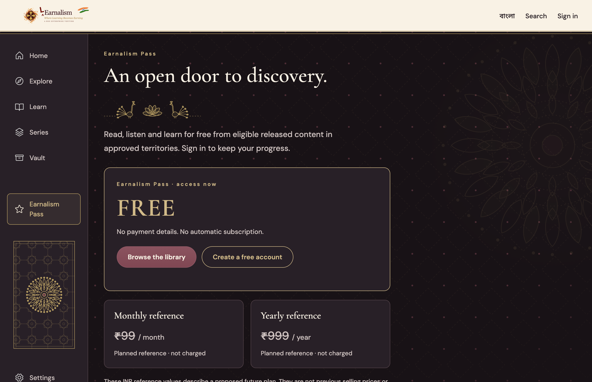
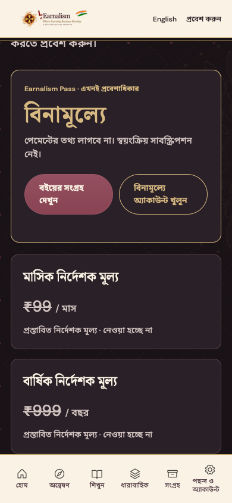

# Owner-approved free rollout — 19 November 2026

Isolated web, maintenance and archive are live on application commit `061ad0a93159a905f74dadccd61e393f9dfbe700`. [Deployment receipt](deployment.json). Approved migration0011 is applied; numbering no longer restarts when approval version changes within one visible prefix series. All71 immutable assets verified; public HTTPS checksum and MISS→HIT passed.

498 backend and32 client tests passed; exact application-head CI succeeded. Live public desktop Chromium/Firefox and phone-sized WebKit validation passed39/39. Prior native Safari evidence is reused; phone WebKit is a virtual browser, not physical iOS UAT. The final original local per-case receipts became unavailable when the workspace disappeared; this aggregate records completed observed checks without reconstructing per-case data. Source-preserved local browser receipts remain alongside this report. A fresh deployed desktop screenshot was captured after recovery.

Actual access is FREE for eligible released content within existing publication, territory and account boundaries. ₹99/month and ₹999/year are struck-through planned references, never previously charged. No payment details or automatic future charges. Historical checkout and financial controls remain; future paid activation still requires exact terms and actual provider/document acceptance.

Final database-enforced READ ONLY verification found the protected draft unchanged (version42,32paragraphs,null live pointer,original SHA),0011 recorded and series_prefix present. Live offers/pending orders/nonterminal subscriptions/authorized or pending mandates/counters/invoices/credit notes were all zero. No financial mutation occurred. Actual draft catalog404 and legacy HTTPS200. Plans, schedules, backup credentials, book and legacy unchanged. Physical Android/iOS and OS-specific UAT are deferred and non-blocking.

