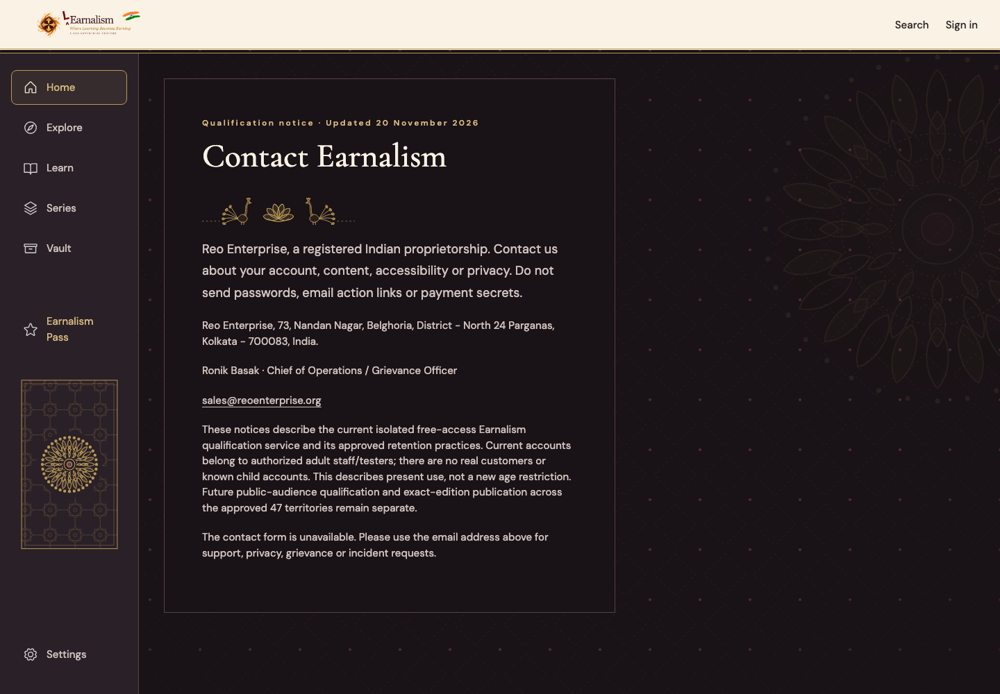
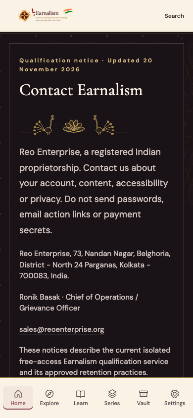

# Approved grievance contact publication —21 November 2026

The owner explicitly approved publishing **Ronik Basak** with **sales@reoenterprise.org** as Earnalism’s grievance contact. The pretested public-name runtime setting was saved/readback-verified and deployed to the existing isolated web service. [Actual receipt](receipt.json). Source/schema/assets are unchanged; qualified commit `4982223` and static release remain in use. Both existing cron builds remain on the qualified runtime; no extra job, plan, mail, book publication or DNS action occurred.

[Contact](https://maison.theearnalism.com/en/contact/) and [Privacy](https://maison.theearnalism.com/en/privacy/) show the approved professional name/business mailbox. Personal phone, personal Gmail and private CERT-In submission remain unpublished.30live desktop/virtual-phone Chromium/Firefox/WebKit checks and2nativeSafari notice checks PASS. English and historic Bengali aliases share the same notice; consent defaults and all-language catalog smoke checks pass. [Cross-browser detail](browser.json), [nativeSafari](safari.json). The first native run raced document readiness; the condition-based rerun passed without a product change.

Read-only draft/null-live/version42/32paragraphs/original hash,zero finance records,scheduled maintenance/clear lease and legacyHTTPS200 are unchanged. Existing full runtimeCI/crypto/asset acceptance is reused within its actual scope. Physical Android/iOS/OS-specific UAT remains deferred/nonblocking. This closes the earlier current officer-name approval item; future public/all-ages,productionHA,paid and exact-title scopes remain distinct.

