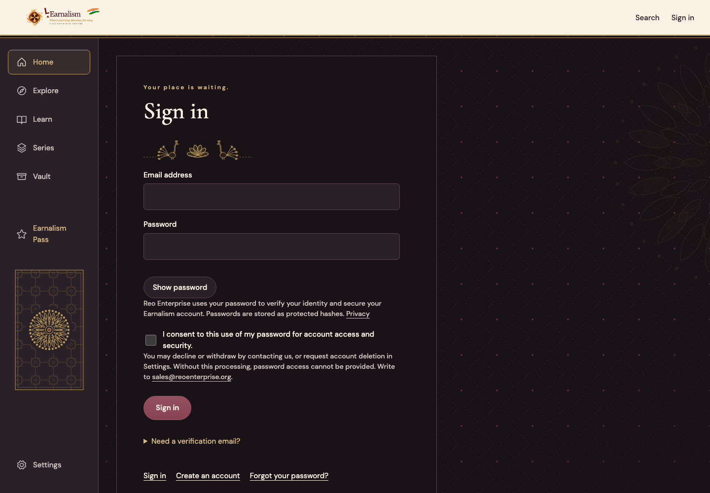
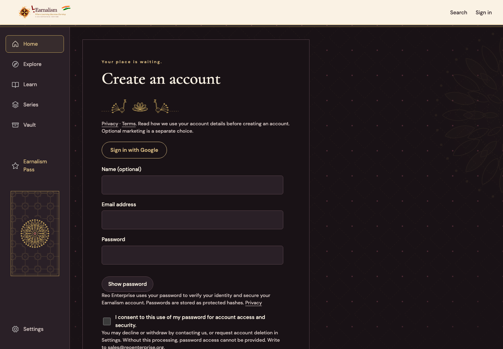
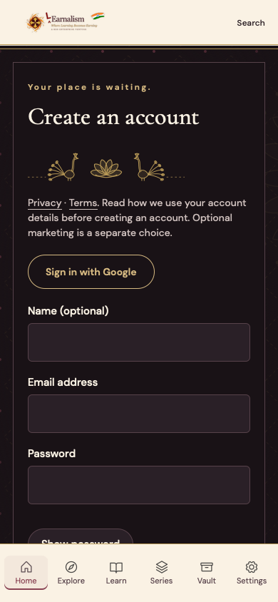

# India-only operating follow-up

Current owner facts and bounded law/purpose assessment: [assessment](current-india-assessment.md). Exact47-region applicability/source review: [matrix](region-operating-triage.md), [JSON](region-operating-triage.json). Primary supplemental research: [BT/IQ/MV](regions-bt-iq-mv.md), [PK/YE/KH](regions-pk-ye-kh.md). These records do not certify future public/all-ages operation or exact-title publication.

Candidate behavior: explicit prospective password-purpose choice before reader/staff password actions; minimal successful-action receipts; no historic consent backfill or optional marketing bundling. Hold-aware180day receipt expiry preserves7day untouched signup cleanup. Public grievance name is escaped/configured only following separate exact publication approval; private CERT contact details remain outside Git and off the website.

Testing, exact candidate/CI, immutable asset publication, provider deployment and end-to-end receipts will be added after actual verification. Physical Android/iOS/OS-specific UAT remains deferred/nonblocking; book draft and legacy unchanged. Existing security/archive/restore receipts remain valid within their unchanged scope and are not falsely repeated as newly performed.

Actual source checks: 38 focused account/retention and 74 web tests,37client tests,TypeScript/production build/migration check PASS. The final local621run passed620 with only its already-loaded old journey fixture failing; the corrected real signup/verification/reading journey passed separately. A fresh exact-head fullCI is required before deployment. [Source detail](source-checks.json). [58 local desktop/virtual-phone browser checks](browser.json) and [6 native Safari desktop checks](safari.json) PASS. [72 immutable assets](public-assets.json) passed all HTTPS checksums/types/cache metadata with actual MISS→HIT. Public-name approval and deployed acceptance are still distinct.

## Deployed acceptance

PR#17/main `4982223` passed fresh exact-mainCI44796158557:621backend tests (20age-dependent CI skips covered by actual local execution),37client tests and no migration. Web is Live; both existing cron builds report the same successfully deployed commit. Actual scheduled maintenance succeeds/lease clear. [Deployment receipt](deployment.json).108live Chromium/Firefox/phoneWebKit checks and5nativeSafari desktop checks PASS; existing authenticated operator UI mounts both unchecked consent controls using the new bundle without a credential/profile change. [Live browsers](live-browser.json), [nativeSafari](safari-live.json). No new archive run/restore is claimed; valid unchanged security/archive recovery evidence is reused.

The [read-only invariants](final-invariants.json) confirm protected draft/null live/version42/32paragraphs/original hash,zero finance records and legacyHTTPS200. Physical UAT is deferred/nonblocking.

**Only current operating approval pending:** publish the professional grievance officer name with the existing business mailbox. The tested public rendering remains blank by default until that exact owner approval; private CERT phone/email/submission are not published or embedded. Future public/all-ages,productionHA,paid activation and exact-title publication retain their separate stated scopes.

