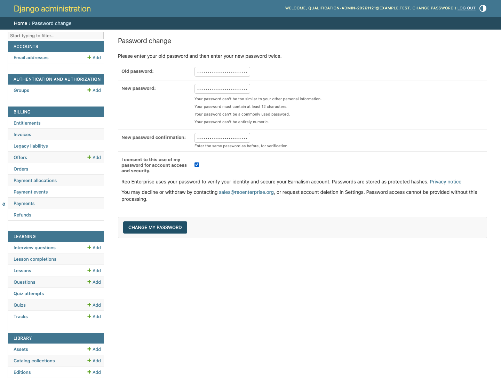
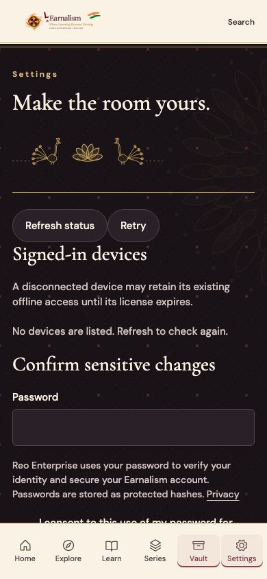

# Final isolated free-access P0 corrections —21November2026

This candidate fixes four concrete reviewed defects: Settings now offers the existing mailbox when support collection is disabled; known503 clearly states no collection; staff password change renders its mandatory purpose fields and complete explanation; account operations/default-row creation recheck live authority after the actor lock, preserving normal replay/session rotation; packaged Django admin assets/licences are included inside the existing immutable Maison namespace after deployed stylesheet404 was confirmed. The same check fences staff authenticator enrollment/confirmation/verification/recovery under the actor lock. No public/client authority flag or new service is introduced.

Actual source checks:635PostgreSQL tests with zero skips,37client tests,TypeScript/production build PASS before the final small reuse of the same lock check in staff MFA. Final MFA+authority14focused tests then PASS; exact-head fullCI remains required.44focused authority/account tests include actual PostgreSQL blocking locks and zero callback/receipt after deletion/reset/revocation.7focused frontend and10static tests PASS;23free catalog/Series/learning regressions found no additional defect. Counts overlap and are not summed. [Details](source-checks.json).

13local desktop/phone Chromium/Firefox/WebKit checks and3nativeSafari staff checks PASS. Staff password changes restore the original fixture password, preserve current-session preference writes and revoke old authority/other devices. Settings excludes the disabled support bundle; a controlled stale-form503 displays truthful no-collection text without sending mail. Native Safari required opening the existing app; the harness was corrected to select the password form instead of the separate header logout form. Staff-MFA readiness is preserved. [Browser detail](local-browser.json), [nativeSafari](native-safari-local.json).

The [current register](../../PENDING_VALIDATIONS.md) separates actual enabled isolated-free work from future paid/title/public/HA acceptance and owner-deferred nonblocking physical UAT. The previous register is preserved with rebased links and a source hash. Exact-headCI, immutable publication and deployment/live invariants will be recorded after actual completion. The protected book draft, legacy,47-region/all-ages policy and approved provider plans remain unchanged.

